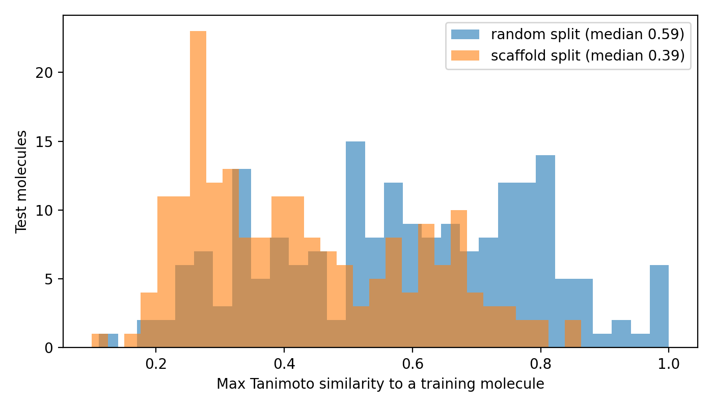
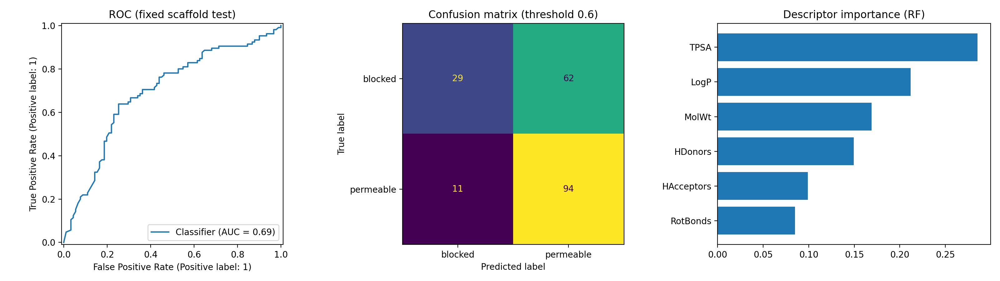

# Blood-Brain Barrier Permeability Prediction (BBBP)



Predicts whether a molecule can cross the blood-brain barrier from its structure,
evaluated with a **scaffold split** so the test set contains structurally unfamiliar molecules.

## Results

| Features | Fixed scaffold test AUC | Recall (blocked) | Recall (permeable) | CV AUC, random | CV AUC, scaffold |
|---|---|---|---|---|---|
| Fingerprint | 0.701 | 0.341 | 0.886 | 0.929 +/- 0.013 | 0.901 +/- 0.021 |
| Descriptors | 0.694 | 0.319 | 0.895 | 0.894 +/- 0.013 | 0.869 +/- 0.025 |
| Both | 0.751 | 0.418 | 0.848 | 0.938 +/- 0.013 | 0.911 +/- 0.024 |

Random Forest, 500 trees, class-balanced. Decision threshold chosen on the validation set.
On the fixed scaffold test split (196 molecules), the combined model reached
ROC-AUC 0.751 (95% bootstrap CI 0.68-0.815).



## Key findings
1. The fixed scaffold test split is much harder than cross-validation (about 0.70-0.75 vs about 0.87-0.91 AUC).
   The similarity plot above shows why: its test molecules are less similar to the training set
   (median max Tanimoto 0.39) than a random split's (0.59).
2. Random CV is consistently a little more optimistic than scaffold-grouped CV (about 0.03 AUC).
3. TPSA and LogP are the most important descriptors, consistent with known BBB rules.
4. The model finds most permeable molecules but misses over half of the blocked ones.

## Method
- Data: MoleculeNet BBBP (Hugging Face copy, 2,039 molecules)
- Cleaning: kept the largest fragment (removes salts); removed 22 rows with conflicting labels
  and 62 duplicates, leaving 1,955 molecules
- Split: Bemis-Murcko scaffold split, 1,564 / 195 / 196 (train / valid / test);
  zero scaffold overlap between sets (checked in code)
- Features: Morgan fingerprints (radius 2, 2048 bits) and 6 RDKit descriptors
  (MolWt, LogP, TPSA, H-bond donors/acceptors, rotatable bonds)
- Metrics: ROC-AUC and per-class recall (about 76% of molecules are permeable, so accuracy is misleading)

## Limitations and what I would do differently
The test set is only 196 molecules, so the confidence interval is wide and the differences between
feature sets are within noise. The threshold was tuned on a validation set that did not resemble
the test set, and results come from one scaffold split. With more time I would repeat the pipeline
over several seeds and splits, try a clustering-based split, and compare against a graph neural network.

## Run it
```
pip install -r requirements.txt
python -m src.train
```
The dataset downloads automatically on first run (`data/` is git-ignored).

## Citations
- Wu et al., MoleculeNet: a benchmark for molecular machine learning, Chem. Sci. 2018, 9, 513-530.
- Martins et al., A Bayesian approach to in silico blood-brain barrier penetration modeling,
  J. Chem. Inf. Model. 2012, 52, 1686-1697.